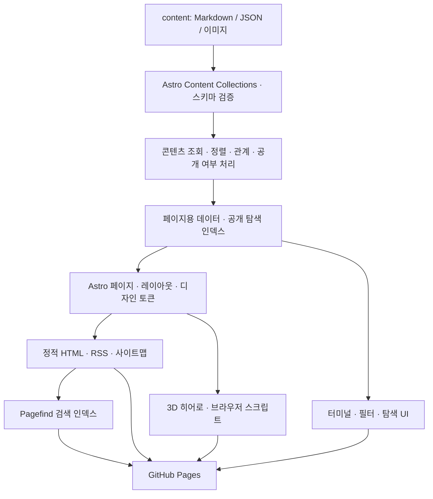

# GitHub 프로필 · 포트폴리오 · 블로그 기획서

작성일: 2026-10-01 · 구현 현황 갱신: 2026-10-02 · 버전: 0.2

개인 프로필, 프로젝트, 개발 글, 기타 글을 한곳에 모으는 Astro 웹사이트를 만든다. 콘텐츠는 독립된 파일과 스키마로 관리하고, 디자인은 이를 표현하는 교체 가능한 계층으로 구성한다. 화이트 홈은 실제 3D 오브젝트와 입체 인터랙션으로 발전시키고, 다크 터미널은 동일한 콘텐츠를 탐색하는 별도 경험으로 제공한다.

구현 경계와 코드 계약은 [아키텍처 상세 설계](./아키텍처-상세.md)에 정의한다. 이 기획서는 기능과 제품 방향을, 상세 설계는 모듈 의존 규칙·디자인 교체 방식·변경 시 검증 기준을 담당한다.

이 문서의 본문은 최초 기획 당시의 목표와 후보안을 보존한다. 2026-10-02 현재 Astro 정적 사이트의 첫 구현은 저장소에 있으며, 실제 사용법은 [README](../README.md)와 [콘텐츠 작성 안내](./콘텐츠-작성.md)를 따른다. 아래의 구현 현황과 차이에는 현재 코드로 확인되는 범위만 기록한다. GitHub Pages 공개 배포와 실제 개인 콘텐츠 교체는 아직 수행하지 않았다.

### 첫 구현 현황과 원안의 차이

| 영역 | 2026-10-02 구현 상태 |
| --- | --- |
| 사이트와 콘텐츠 | 홈·소개·글·프로젝트·태그·검색·터미널·RSS·사이트맵을 정적으로 생성한다. 프로필과 글·프로젝트는 교체 가능한 예제다. 초안과 미래 발행 항목은 공개 카탈로그에서 제외한다. |
| 디자인과 3D | `src/designs/studio/`에 화이트 홈, 다크 테마와 터미널, 포스터 폴백이 있다. Three.js 장면은 `hero/`에서 필요할 때 로드한다. 본문·UI는 자체 호스팅 Noto Sans KR, 코드·터미널은 시스템 고정폭 글꼴을 쓴다. |
| 탐색 | 검색은 `/search/` 페이지이며 모달은 없다. 프로젝트 목록은 기술 필터를 제공하고, 상태 필터는 아직 없다. 목차 링크는 정적이며 읽는 위치의 활성 항목 추적은 없다. 터미널 명령은 현재 `commands.ts`의 분기문으로 처리한다. |
| 콘텐츠 계약 | 실제 스키마에는 `cover`, `coverAlt`, `endedAt`, 프로필 `avatar`, 외부 블로그 `feedUrl`·`order`가 없다. 글·프로젝트 본문 이미지는 상대 경로와 대체 텍스트로 작성한다. |
| 검증·배포 | 타입·콘텐츠·경계 검사, 정적 빌드와 Pagefind, 산출물·브라우저 검증, GitHub Actions의 수동 Pages 배포 경로를 마련했다. 실제 Pages 공개는 별도 작업이다. |

아래에서 이 표와 다른 세부 동작, 데이터 필드, 성능 수치는 첫 구현 완료 사항이 아니라 원래 목표 또는 후속 확장안이다.

## 1. 목표와 기본 가정

- 방문자가 첫 화면에서 어떤 개발자인지 이해하고, 대표 프로젝트와 최근 글로 이동할 수 있게 한다.
- 개발 블로그와 기타 블로그를 구분하되, 검색과 태그에서는 함께 발견할 수 있게 한다.
- 디자인을 전면 변경해도 글 본문, 프로젝트 설명, 프로필 데이터와 공개 URL을 유지한다.
- 글 작성은 Markdown 파일 추가와 메타데이터 작성으로 끝나게 한다.
- 데스크톱에서는 입체감과 탐색의 재미를 제공하고, 모바일에서는 읽기와 이동을 우선한다.

여기서 “GitHub 프로필 페이지”는 GitHub 프로필에서 연결하는 독립 웹사이트로 해석한다. GitHub 프로필 README 자체에는 이 웹사이트의 3D와 터미널 동작을 넣지 않는다. 배포는 GitHub Pages를 기본안으로 잡으며, 실제 계정·저장소·도메인은 구현 시 설정한다.

개발 블로그와 기타 블로그는 사이트 내부에 글을 작성하는 형태를 기본으로 한다. 이미 운영 중인 외부 블로그는 링크 목록으로 함께 소개할 수 있도록 데이터 구조를 마련한다. 외부 글 전체 수집과 자동 동기화는 후속 범위다.

## 2. 제공된 디자인 시안 분석

검토 대상: 루트의 `Astro 포트폴리오 블로그 설계.zip`.

| 파일 | 확인된 내용 | 활용 방향 |
| --- | --- | --- |
| `Portfolio Home.dc.html` | 신문·매거진·문예지 홈 1a~1c, 터미널·호버 인덱스·작업 책상 2a~2c, 가상 파일시스템 터미널 3a | 타이포그래피, 글 목록, 카드와 탐색 방식 참고 |
| `Portfolio.dc.html` | 4a: 라이트 일반 페이지와 다크 터미널 전환, 홈·글·글 상세·프로젝트·이력, 검색·태그·목차·복사 | 전체 정보 구조의 기준 시안 |
| `.thumbnail` | 시안 묶음의 WebP 미리보기 | 구성과 시각적 방향 참고 |
| `support.js` | 디자인 시안 실행 지원 파일 | 제품 코드로 직접 가져오지 않음 |

시안은 `x-dc`, `DCLogic`, 템플릿 바인딩 등을 사용하는 프로토타입이다. 본문과 프로젝트 데이터도 UI 로직에 포함되어 있어 Astro에서 구조를 다시 구성해야 한다. HTML 소스와 썸네일을 검토했으며, 원본 프로토타입의 모든 동작을 브라우저에서 검증한 상태는 아니다.

홍길동, 군 복무 이력, 이메일, 프로젝트, 게시글은 시안의 샘플이다. 실제 사용자 정보로 확정하지 않는다. KO/EN 전환과 좋아요도 시안 기능이며, 1차 구현의 필수 기능으로 자동 확정하지 않는다.

**채택 방향:** 4a의 일반 페이지와 터미널 전환을 중심으로, 2b의 글 미리보기와 2c의 작업 책상에서 입체 카드 표현을 가져온다. 화이트 홈에 3D를 새로 설계한다. 자유로운 카드 드래그는 후속 실험으로 두고, 기본 탐색은 안정적인 그리드와 링크로 제공한다.

## 3. 콘텐츠와 사이트맵

| 영역 | URL | 주요 내용 |
| --- | --- | --- |
| 홈 | `/` | 프로필 요약, 3D 히어로, 대표 프로젝트, 최근 개발 글·기타 글, 외부 블로그 |
| 프로필 | `/about/` | 소개, 기술, 이력, 현재 관심사, GitHub·연락처 |
| 프로젝트 목록 | `/projects/` | 기술·상태 필터, 대표 프로젝트 구분 |
| 프로젝트 상세 | `/projects/[slug]/` | 문제, 역할, 구현 과정, 결과, 스크린샷, 저장소·데모, 관련 글 |
| 전체 글 | `/blog/` | 개발·기타 탭, 태그, 날짜 정렬, 검색 진입 |
| 개발 블로그 | `/blog/dev/` | 개발 글 목록 |
| 기타 블로그 | `/blog/life/` | 일상·회고·취미 등 기타 글 목록 |
| 글 상세 | `/blog/posts/[slug]/` | 본문, 목차, 코드 블록, 관련 글, 공유 링크 |
| 태그 | `/tags/`, `/tags/[tag]/` | 태그 목록과 관련 글·프로젝트 |
| 검색 | `/search/` | 글과 프로젝트 통합 검색, 모바일 진입점 |
| 터미널 | `/terminal/` | 명령어와 클릭으로 동일 콘텐츠 탐색 |
| 피드·기타 | `/rss.xml`, `/sitemap-index.xml`, `/404.html` | 구독, 검색엔진 발견, 잘못된 주소 안내 |

`dev`, `life`는 내부 분류 ID다. 화면에는 “개발 블로그”, “기타 블로그”로 표시한다. 상세 URL에 분류를 넣지 않아 글의 분류를 바꿔도 링크가 유지된다. `slug`는 발행 후 고정하고, 변경이 필요한 경우 예전 경로에서 이동할 수 있는 정적 안내 페이지를 만든다.

홈의 읽기 순서는 헤더 → 프로필과 3D 히어로 → 대표 프로젝트 → 최근 글 두 그룹 → 외부 블로그와 연락처다. 글이 없는 그룹은 빈 상태 안내를 표시하고 임의의 샘플 글을 실제 콘텐츠처럼 노출하지 않는다.

## 4. 화이트 디자인 개편

### 4.1 시각적 컨셉: 입체적인 개발자의 작업 공간

화이트 배경 위에 프로필, 프로젝트, 글을 서로 다른 깊이의 오브젝트처럼 배치한다. 시안의 큰 이름 타이포그래피와 간결한 글 목록을 유지하면서, 히어로의 3D와 카드의 움직임으로 개성을 만든다.

- 배경: 화이트 `#FAFAF8`, 표면: `#FFFFFF`, 텍스트: `#18181B`를 초기 후보로 사용한다.
- 강조색: 시안의 오렌지를 잇는 `#C2410C`를 초기 후보로 사용하며, 실제 글자·버튼 조합의 대비를 검증한다.
- 재질: 부드러운 무광 표면, 얇은 테두리, 가까운 접촉 그림자와 넓은 주변 그림자를 조합한다.
- 타이포그래피 원안: 본문·UI는 Pretendard, 터미널·코드는 IBM Plex Mono와 한글 폴백을 사용한다. 첫 구현의 실제 서체는 위 현황을 따른다.
- 화면 구성: 데스크톱 홈은 소개와 3D의 2열 구성, 글 목록은 텍스트 중심, 프로젝트는 이미지 중심 카드 구성으로 구분한다.
- 색·간격·모서리·그림자·깊이·모션을 디자인 폴더의 CSS 변수로 정의한다. 원시값 → 의미 토큰 → 컴포넌트 순으로 사용하며 콘텐츠 데이터에 색상이나 회전값을 넣지 않는다.

### 4.2 실제 3D와 CSS 입체 효과의 역할

히어로에는 **Three.js 기반 실제 3D 장면 하나**를 둔다. 초기 오브젝트는 프로필 카드, 프로젝트를 상징하는 큐브, 글을 상징하는 얇은 책 형태로 구성한다. 기본 도형으로 제작해 외부 모델·텍스처 의존을 줄이고, 커서 위치에 따라 제한된 범위에서 시점과 기울기가 변하게 한다. Three.js는 장면·카메라·렌더러로 3D를 구성할 수 있다. [Three.js 공식 안내](https://threejs.org/manual/pages/creating-a-scene.html)

주요 제목, 소개, 버튼은 실제 HTML로 제공한다. 3D는 장식이며 중요한 정보나 탐색 경로를 캔버스 안에만 배치하지 않는다. 히어로 아래의 글·프로젝트 카드는 CSS `perspective`, `transform`으로 입체감을 표현하고, 각 카드에 WebGL 캔버스를 만들지 않는다.

| 위치 | 데스크톱 인터랙션 | 모바일·동작 줄이기 설정 |
| --- | --- | --- |
| 히어로 | 커서에 따른 약한 시차와 회전, 짧은 등장 연출 | 기본은 정적 포스터, 소개와 버튼 즉시 표시 |
| 프로젝트 카드 | 기울기 최대 약 6°, 상승 최대 약 6px, 그림자 변화 | 평면 카드, 탭으로 상세 이동 |
| 글 목록 | 호버·키보드 포커스 시 작은 커버 미리보기 | 요약과 작은 썸네일을 목록 안에 표시 |
| 버튼·탭 | 150~250ms 색·위치 피드백 | 같은 기능 제공, 동작 줄이기에서는 위치 변화 제거 |
| 화면 모드 전환 | 시안의 원형 확산 연출을 짧게 적용 | 즉시 전환 또는 짧은 페이드 |
| 글 상세 | 목차 활성 표시와 명확한 링크 피드백 | 본문 읽기 중심, 지속적인 3D 효과 없음 |

타이핑 문구는 장식으로만 사용하고, 정적인 소개 문장도 함께 제공한다. 스크롤 강제 이동, 커서 교체, 긴 부팅 대기는 사용 흐름에 넣지 않는다. 3D의 지속 움직임은 사용자가 끌 수 있게 한다.

### 4.3 반응형과 접근성

- 360px부터 가로 넘침 없이 사용할 수 있게 한다. 768px, 1200px를 초기 레이아웃 전환 기준으로 두고 실제 콘텐츠로 조정한다.
- 모바일 홈은 소개 → 정적 3D 포스터 → 프로젝트 → 글 순서의 한 열로 전환한다.
- 카드 전체 링크와 내부 버튼의 클릭 영역이 충돌하지 않도록 구성한다.
- 미리보기는 호버뿐 아니라 키보드 포커스로도 제공하고, 본문을 가리지 않는다.
- 기본 터치 대상은 약 44×44px 이상으로 설계하고, 포커스 표시·본문 대비·건너뛰기 링크를 제공한다.
- `prefers-reduced-motion`에서는 시차, 회전, 타이핑, 원형 확산을 중단한다. 자동 움직임을 끄는 별도 제어도 제공한다.
- JavaScript 또는 WebGL을 사용할 수 없을 때도 프로필, 목록, 글, 링크를 읽고 이동할 수 있게 한다.

## 5. 다크 터미널 경험

터미널은 실제 OS 셸이 아닌, 공개 콘텐츠를 대상으로 하는 가상 탐색 UI다. 글과 프로젝트의 제목·요약·태그·URL로 가상 디렉터리를 생성한다.

| 명령어 | 동작 |
| --- | --- |
| `help`, `whoami`, `contact` | 도움말, 프로필 요약, 연락처 |
| `ls`, `cd`, `pwd` | `~/blog/dev`, `~/blog/life`, `~/projects` 등 가상 경로 탐색 |
| `cat <file>` | 요약·메타데이터와 실제 상세 페이지 링크 제공 |
| `grep <tag>` | 공개 콘텐츠 태그 조회 |
| `search <query>` | 통합 검색 열기 |
| `history`, `clear` | 세션 명령 기록, 출력 지우기 |
| `theme light`, `theme dark` | 색상 테마 변경 |
| `exit` | 현재 콘텐츠의 일반 페이지로 복귀 |

명령어 버튼, Tab 자동완성, ↑/↓ 기록 탐색을 제공하되 입력창 내부에서만 해당 키를 처리한다. Cmd/Ctrl+K로 검색을 열고 Esc로 닫는다. 모바일에서는 명령어 바로가기와 단일 열 요약 뷰어를 제공한다.

시안의 “화이트 페이지 ↔ 다크 터미널” 전환 버튼을 대표 경험으로 유지한다. 내부 상태는 `theme: light|dark`와 `experience: web|terminal`로 분리하고, 일반 페이지에서도 다크 테마로 글을 읽을 수 있게 한다. 운영체제 다크 설정만으로 방문자를 터미널로 보내지 않는다. 모드 변경 시 현재 글·프로젝트의 주소와 복귀 대상을 유지한다.

터미널 요약은 별도 글 복사본을 만들지 않고 공개 메타데이터에서 생성한다. 1차 본문 읽기는 정적 상세 페이지로 연결한다. 시안의 분할 뷰어는 요약 미리보기부터 구현하고, 본문 전체 표시가 필요해지면 동일한 빌드 콘텐츠에서 생성하는 방식으로 확장한다.

## 6. 선정 아키텍처

**Astro 정적 생성(SSG) + 콘텐츠 중심 계층 구조 + 필요한 영역의 독립 인터랙션**을 채택한다. 프로필·목록·본문은 빌드 시 HTML로 생성하고, 3D·검색·터미널에만 브라우저 코드를 붙인다. Astro의 Islands 구조는 인터랙티브 영역을 독립적으로 로딩하는 접근을 지원한다. [Astro Islands 공식 문서](https://docs.astro.build/en/concepts/islands/)

구현 형태는 **모듈형 단일 앱**으로 정한다. 콘텐츠 저장소 경계는 Adapter, 화면 경계는 View Model과 슬롯, 동작 경계는 기능별 controller로 나눈다. 전체 리디자인은 새 디자인 폴더를 만들고 `presentation/active-design.ts`의 정적 연결을 바꾸는 방식으로 처리한다. 아래 그림은 데이터·산출물 흐름이며, 코드 import 방향은 상세 설계 2절을 따른다.



### 6.1 계층과 책임

| 계층 | 책임 | 변경 예시 |
| --- | --- | --- |
| 콘텐츠 | 사실, 글, 프로젝트 기록, 의미 있는 이미지·대체 텍스트 | 글 추가, 소개 수정 |
| 콘텐츠 규칙 `core/` | 프레임워크 독립 모델, 공개 조건, 정렬·관계·URL 함수 | 공개 정책 변경 |
| 콘텐츠 접근 `adapters/` | 컬렉션 로딩, 스키마, 이미지 해석, 본문 렌더링 | 나중에 저장소나 CMS 교체 |
| 조회·변환 `application/` | 공개 카탈로그, 페이지 조회, VM과 탐색 인덱스 | 추천 글 규칙 변경 |
| 조립 `server/`, `pages/` | 실제 adapter 연결, 경로 생성, 문서와 뷰 조립 | 배포 경로 설정 |
| 표현 `presentation/`, `designs/` | 공통 문서·본문 경계, 활성 디자인, 페이지 뷰·카드·토큰 | 화이트 홈을 다른 디자인으로 교체 |
| 인터랙션 `features/` | 검색·필터·터미널·설정의 로직과 DOM 연결 | 탐색 기능 추가 |
| 디자인 전용 3D `designs/studio/hero/` | 장면·재질·모션, 로딩과 자원 정리 | 3D 교체 또는 제거 |

일반 페이지와 터미널이 동일한 공개 데이터와 URL 생성 함수를 사용한다. 브라우저에 전달하는 탐색 인덱스에는 제목·요약·태그·종류·URL만 넣고, 전체 본문은 담지 않는다. 표현 계층에서 글 파일을 직접 파싱하거나 UI마다 공개 여부 필터를 다시 구현하지 않는다.

Astro 컬렉션 타입은 adapter 안에서 사이트 모델로 변환한다. 페이지 데이터에는 색·그리드·회전 같은 표현 속성을 넣지 않는다. 본문은 공개 ID로 렌더링한 Astro Content를 슬롯으로 전달하고, 디자인은 제목·목차·본문·관련 글의 배치를 담당한다. 빌드 코드와 브라우저 코드의 import 경계를 검증한다.

### 6.2 디자인 패턴 선정

| 패턴 | 적용 위치 | 선택 이유 |
| --- | --- | --- |
| 관심사 분리와 단방향 의존 | 상세 설계의 import 허용 규칙 | 핵심 콘텐츠 규칙이 UI·Astro·DOM에 의존하지 않음 |
| Repository / Adapter | `application/content-source.ts`, `adapters/astro-content/` | 필요한 읽기 계약만 두고 저장소 접근을 격리 |
| View Model / Presenter | `application/contracts/`, `application/presenters/` | 원본 모델을 표시 데이터로 변환, 디자인에는 타입만 공유 |
| 컴포넌트·슬롯 합성 | `presentation/ArticleBody.astro`, 디자인의 페이지 뷰 | 본문·공통 기능을 유지하며 레이아웃 교체 |
| 디자인 토큰 | `designs/studio/styles/` | 원시값·의미·컴포넌트 구분으로 색·깊이·간격·모션 변경 |
| Headless Controller | `features/`의 기능별 상태·DOM 연결 | 검색·필터·터미널의 동작과 마크업 분리 |
| Progressive Enhancement | HTML → 필터·검색·3D | 기본 탐색과 읽기가 스크립트 실패에도 작동 |
| Command + 명시적 상태 전이 | 터미널 명령 레지스트리, 모드·검색 상태 | 명령 추가와 오류 처리를 일관되게 관리 |

패턴은 작은 TypeScript 모듈과 함수로 구현한다. 범용 Repository 프레임워크, DI 컨테이너, 대형 상태 머신 라이브러리는 초기 규모에 필요하지 않다. UI를 기술별 폴더에만 모으는 대신 콘텐츠·검색·터미널·3D처럼 변경 목적이 같은 기능을 묶는다.

페이지 뷰가 데이터 조회를 수행하거나 모든 디자인을 불리언 props로 처리하는 만능 컴포넌트는 만들지 않는다. 공통화는 실제로 두 곳 이상에서 같은 의미와 변경 이유를 공유할 때 수행한다. 구체적인 계약 예시와 변경 시나리오는 상세 설계 4~10절을 따른다.

### 6.3 기술 선정

| 기술 | 결정과 범위 |
| --- | --- |
| Astro + TypeScript strict | `.astro` 템플릿과 TypeScript로 구현, 정적 출력 사용 |
| Astro Content Collections | 빌드 시 Markdown·JSON 로딩, 스키마 검증, 타입 생성 |
| Markdown | 일반 글과 프로젝트 본문의 기본 형식 |
| MDX | 초기에는 도입하지 않음. 필요 시 의미 기반 공통 컴포넌트만 허용 |
| CSS 변수 + 컴포넌트 CSS | 디자인 토큰과 범위가 명확한 스타일, 초기 CSS 프레임워크 미사용 |
| Three.js | 화이트 홈 히어로의 실제 3D, 동적 import로 분리 |
| 브라우저 TypeScript / Custom Elements | 필터, 터미널, 검색, 3D 초기화. 초기 React·Vue 런타임 미도입 |
| Pagefind | 정적 빌드 결과에서 글·프로젝트 검색 인덱스 생성 |
| Astro RSS·Sitemap 통합 | 공개 글 피드와 검색엔진용 사이트맵 생성 |
| GitHub Actions + GitHub Pages | 검증·정적 빌드·검색 인덱스·배포 파이프라인 |

Astro Content Collections는 콘텐츠 로딩과 스키마 검증을 제공하며, 정적 상세 경로는 페이지 코드에서 생성한다. [Content Collections 공식 문서](https://docs.astro.build/en/guides/content-collections/)

프레임워크 컴포넌트를 도입하는 경우 `client:visible` 등의 지시어를 적용할 수 있다. 초기안의 일반 스크립트·Custom Elements에는 이를 붙이지 않고, `IntersectionObserver`와 동적 import로 3D 로딩을 제어한다. [Astro 스크립트 공식 문서](https://docs.astro.build/en/guides/client-side-scripts/)

페이지 이동은 기본 브라우저 이동으로 시작한다. 모드 전환은 전용 UI에서 처리한다. 이후 Astro `ClientRouter`를 도입할 경우 검색·터미널·3D의 재초기화와 정리, 포커스·스크롤 복원을 함께 검증한다. 해당 라우터는 동작 줄이기 설정에 대한 전환 처리도 제공한다. [Astro View Transitions 공식 문서](https://docs.astro.build/en/guides/view-transitions/)

첫 구현은 Astro와 의존성을 lockfile에 고정하고 Node.js 22.19 이상을 요구한다. 정확한 설치 명령과 버전은 `package.json`과 README를 따른다.

## 7. 웹과 글의 분리 구조

초기에는 한 저장소 안에서 물리적 디렉터리를 분리한다. 데이터 파일과 UI 사이에 조회 모듈을 두어 이후 콘텐츠를 별도 저장소로 옮길 수 있게 한다. 별도 저장소는 당장 운영 부담을 추가하므로 초기 필수 조건으로 두지 않는다.

```text
/
├── content/                     # 디자인과 독립된 원본 콘텐츠
│   ├── profile/profile.json
│   ├── posts/dev/*.md
│   ├── posts/life/*.md
│   ├── projects/*.md
│   ├── external-blogs.json
│   └── assets/                  # 콘텐츠용 이미지·첨부
├── src/
│   ├── content.config.ts        # 컬렉션과 스키마
│   ├── core/                   # 모델·순수 규칙·URL 함수
│   ├── application/            # 저장소 계약·공개 카탈로그·조회·VM
│   ├── adapters/astro-content/ # Astro 컬렉션·본문·이미지 연결
│   ├── server/                 # 빌드 설정·실제 adapter 연결
│   ├── pages/                  # 실제 라우트와 얇은 페이지 조립
│   ├── presentation/           # 활성 디자인·공통 문서·본문 슬롯
│   ├── designs/studio/         # 뷰·부품·토큰·본문 CSS·3D 장면
│   ├── features/               # 검색·필터·터미널·설정의 동작
│   └── config/site.ts          # 내비게이션·목록 개수 등 사이트 설정
├── public/designs/studio/       # 디자인용 3D 포스터·장식
├── scripts/                    # 콘텐츠·아키텍처·산출물 점검
├── docs/                       # 기획서·아키텍처 상세·작성 안내
└── .github/workflows/           # 검증·수동 배포 워크플로
```

`content/assets`는 글에 속한 자산, `public`의 3D 포스터와 장식은 웹 디자인 자산으로 구분한다. 첫 구현은 Markdown 이미지의 경로와 대체 텍스트를 빌드 때 확인하고 Astro의 본문 이미지 처리를 사용한다. 이미지 최적화와 반응형 크기는 원안의 목표이며, 현재 콘텐츠별 적용 상태를 별도로 확인해야 한다.

### 7.1 데이터 계약

| 데이터 | 주요 필드 |
| --- | --- |
| 공통 발행 메타데이터 | `id`, `slug`, `title`, `summary`, `draft`, `publishedAt`, `updatedAt`, `tags`; 원안의 `cover`, `coverAlt`는 미구현 |
| 글 | `section: dev|life`, `relatedProjects`, Markdown 본문 |
| 프로젝트 | 공통 필드 + `status`, `featured`, `role`, `stack`, `startedAt`, `repositoryUrl`, `demoUrl`, `relatedPosts`, Markdown 본문; `endedAt`은 미구현 |
| 프로필 | `name`, `handle`, `headline`, `bio`, `status`, `skills`, `timeline`, `socialLinks`, 선택적 `email`; 원안의 `avatar`, `avatarAlt`는 미구현 |
| 외부 블로그 | `id`, `title`, `description`, `url`, `section`; 원안의 `feedUrl`, `order`는 미구현 |

글·프로젝트는 안정적인 `id`로 서로 연결한다. `slug`는 URL용으로 사용한다. 프로젝트의 `publishedAt`은 소개 페이지 발행일이며 프로젝트 시작·종료일과 구분한다. 이미지를 지정하면 대응하는 대체 텍스트를 요구한다.

```yaml
---
id: post-content-separation
slug: content-separation
title: 콘텐츠와 디자인을 분리하는 방법
summary: Astro에서 글 원본을 유지하면서 화면을 교체하는 구조를 정리합니다.
section: dev
publishedAt: '2026-10-01T09:00:00+09:00'
draft: true
tags: [astro, architecture]
relatedProjects: [project-personal-site]
---
```

위 예시는 작성 형식이며 실제 발행 콘텐츠가 아니다. `publishedAt`은 [콘텐츠 작성 안내](./콘텐츠-작성.md)처럼 따옴표로 감싼 시간대 포함 ISO 문자열로 쓴다. 화면에서는 한국 시간 기준으로 표시한다. 예상 읽기 시간, 목차, 태그별 건수, 링크는 빌드 시 계산한다. `draft: true` 및 미래 발행 콘텐츠는 공개 HTML·RSS·검색·터미널 인덱스·사이트맵에서 모두 제외한다.

폴더의 `dev/life`와 `section` 값이 일치하는지, ID·slug가 중복되지 않는지, 관계 참조가 존재하는지 빌드 검증한다. 스키마와 태그 ID에 CSS 클래스, 강조색, 애니메이션 이름, 특정 페이지 컴포넌트 import를 넣지 않는다.

Markdown에는 제목, 문단, 목록, 표, 코드, 이미지 같은 의미를 기록한다. 공통 `ArticleBody`가 본문 경계를 제공하고, 디자인의 `prose.css`가 그 경계 내부 스타일을 담당한다. 원시 HTML·인라인 스타일·화면 전용 요소는 기본 작성 규칙에서 제외한다. 향후 MDX가 필요해도 `Callout`, `CodeExample`처럼 의미가 유지되는 공통 요소만 허용한다.

### 7.2 콘텐츠 운영과 디자인 교체

콘텐츠 작성 흐름: Markdown 추가 → 메타데이터·이미지 작성 → 로컬 미리보기 → 스키마·관계 검증 → `draft` 해제 → 커밋 → 빌드·배포. 글 발행은 재빌드 후 반영된다. 미래 날짜는 예약 대상 표시이며, 자동 예약 발행이 필요할 때 별도 시간 기반 빌드를 추가한다.

디자인 변경 흐름: 토큰·뷰·컴포넌트·3D 자산 교체 → 필요하면 활성 디자인 연결 변경 → 동일 콘텐츠로 목록·본문·프로젝트 검증 → 기존 URL·본문 앵커·피드·검색 결과 대상 확인 → 배포. 디자인 변경만으로 `content/`를 수정하지 않는 것을 원칙으로 한다. 별도 콘텐츠 저장소에서는 CI와 loader를 변경하고, CMS처럼 본문 형식이 달라지면 adapter와 본문·이미지 변환도 함께 처리한다. 외부 변경이 UI에 전파되지 않도록 공개 데이터 계약을 유지한다.

## 8. 검색·SEO·상태 관리

- 검색: Astro 빌드 후 Pagefind가 생성된 HTML을 인덱싱한다. 검색 UI는 실행 시 로딩하며 제목·요약·본문, 글 분류·태그를 검색한다. [Pagefind 공식 안내](https://pagefind.app/docs/)
- 검색 범위: 공개 글·프로젝트 상세만 포함한다. 터미널, 중복 목록, 내비게이션은 제외한다. 외부 블로그 링크는 별도 목록으로 찾을 수 있게 하고 외부 글 본문 검색을 보장하지 않는다.
- 필터 상태: `?section=dev&tag=astro&q=...`처럼 URL에 기록하고, 새로고침과 뒤로 가기에서 복원한다. 기본 목록은 JavaScript 없이 제공한다.
- 사용자 설정: 테마·동작 설정만 `localStorage`에 저장하며 접근 실패 시 기본값을 사용한다. 터미널 기록은 세션 상태로 제한한다.
- SEO: 페이지별 제목·설명·canonical·OG, 본문 언어, 이미지 대체 텍스트, 글·인물·프로젝트 성격에 맞는 구조화 데이터.
- RSS: 초기에는 내부 공개 글 전체를 제공한다. 필요하면 개발·기타 분리 피드를 추가한다.
- 다국어: 초기 발행 언어는 한국어. 시안의 영어 전환은 후속 기능이며 번역 글을 준비한 뒤 별도 언어 URL·번역 연결 ID·hreflang을 설계한다.
- 연락: GitHub 링크와 선택적 이메일 표시·복사. 복사 실패 시 주소 선택 또는 `mailto:`로 이동할 수 있게 한다.

## 9. 성능과 품질 기준

아래 수치는 설계 목표이며 측정 결과가 아니다. 실제 콘텐츠와 배포 환경에서 검증 후 조정한다.

| 항목 | 초기 목표·검증 방식 |
| --- | --- |
| 주요 콘텐츠 | 최초 HTML에 프로필·글·프로젝트 및 링크 포함 |
| Core Web Vitals | 실사용 데이터가 확보되면 75백분위 LCP ≤ 2.5초, INP ≤ 200ms, CLS ≤ 0.1 목표 |
| 초기 JS | 3D·검색의 지연 청크를 제외한 초기 전송량 gzip 약 100KB 이내 목표 |
| 3D 추가 비용 | Three.js와 장면 코드 gzip 약 250KB, 포스터 포함 추가 자산 약 500KB 이내 목표 |
| 3D 로딩 | 기본 콘텐츠 렌더 후 가시성·기기 조건을 확인해 동적 로딩, 글 상세에는 로딩하지 않음 |
| 렌더링 | 단일 캔버스, 픽셀 비율 상한 약 1.5, 화면 밖·백그라운드·모션 해제 시 루프 정지 |
| 실패 처리 | WebGL 초기화·컨텍스트 오류·모듈 로딩 실패 시 정적 포스터 유지 |
| 자원 정리 | 페이지 이탈·컴포넌트 제거 시 이벤트·관찰자·루프·GPU 자원 해제 |
| 이미지 | 반응형 크기, 실제 치수 지정, 첫 화면 밖 이미지 지연 로딩 |
| 접근성 | 키보드만으로 탐색·필터·검색·터미널 종료, 모달 포커스 관리, 동작 줄이기 확인 |

포스터와 캔버스는 동일한 공간을 예약해 레이아웃 이동을 막는다. 모바일의 기본 포스터 정책과 성능 예산으로 3D가 글 읽기 속도를 낮추는 문제를 줄인다. INP는 Lighthouse 단일 실행으로 검증 완료 처리하지 않고 실제 상호작용 및 운영 데이터로 평가한다. 지표와 측정 기준은 [Web Vitals 공식 안내](https://web.dev/articles/vitals)를 참고한다.

## 10. 배포와 유지보수

GitHub Pages는 정적 Astro 사이트의 기본 배포 대상으로 사용한다. `site`는 실제 도메인, `base`는 사용자 페이지·프로젝트 저장소 여부에 맞게 설정한다. CSS·이미지·검색 청크·RSS·터미널 링크 모두 공통 URL 생성 규칙을 따른다. [Astro GitHub Pages 배포 안내](https://docs.astro.build/en/guides/deploy/github/)

CI 순서: 의존성 설치 → 타입·콘텐츠 검증 → Astro 정적 빌드 → Pagefind 인덱싱 → 산출물·내부 링크 검증 → Pages artifact 배포. 공개되지 않은 콘텐츠는 인덱싱 전에 제거한다. 브라우저에서 GitHub API를 실시간 호출하지 않고 저장소 링크와 직접 작성한 프로젝트 정보를 기본으로 제공한다.

별도 DB·로그인·관리자 서버는 초기 범위에 포함하지 않는다. 좋아요·조회수·댓글·문의 폼은 저장과 운영 정책이 필요하므로 후속 기능으로 둔다. 시안의 좋아요를 실제 집계처럼 표시하지 않는다. 변경 이력은 Git으로 관리하고 실패한 배포는 이전 정상 산출물을 기준으로 복구한다.

## 11. 구현 단계와 완료 조건

| 단계 | 작업 | 완료 조건 |
| --- | --- | --- |
| 1. 콘텐츠 기반 | Astro 초기화, 스키마, 조회 모듈, URL 정책, 작성 안내 | UI를 편집하지 않고 글·프로젝트 추가 가능, 잘못된 데이터 빌드 실패 |
| 2. 기본 웹 | 홈·프로필·글·프로젝트·태그·404, 본문·이미지 | 모든 실제 URL을 직접 열 수 있고 JavaScript 없이 읽기·이동 가능 |
| 3. 화이트 3D | 히어로, 포스터, CSS 카드, 반응형, 모션 설정 | 실제 3D 동작, 모바일·동작 줄이기·WebGL 실패에서 기본 콘텐츠 유지 |
| 4. 탐색 경험 | 터미널, 검색, 태그·기술 필터, 테마·모드 전환 | 동일 데이터 사용, 뒤로 가기·키보드·복귀 경로 동작 |
| 5. 공개 준비 | RSS·SEO·사이트맵·CI·Pages 경로 검증 | 초안 노출 없음, 검색 인덱스 정상, 배포 경로와 링크 정상 |

위 표는 최초 단계별 완료 조건이다. 첫 구현은 그중 핵심 경로를 갖췄지만 이 문서의 모든 세부 기능을 완료한 상태로 해석하지 않는다. 상태별 프로젝트 필터, 검색 모달, 목차 활성 위치 추적, 일부 시각 효과와 성능 목표 검증은 후속 작업이다. 카드 자유 드래그, 터미널 본문 전체 뷰어, 영어 콘텐츠, 외부 RSS 자동 수집, 댓글·좋아요·조회수, CMS 연동도 후속 범위다.

검증에는 동일 Markdown을 두 가지 임시 레이아웃으로 렌더링해 본문과 공개 URL이 유지되는지 확인하는 디자인 교체 점검을 포함한다. 기능 검증은 공개 정책·관계 참조·URL 생성·터미널 명령 파싱에 집중하고, 접근성·모바일·3D 성능은 브라우저에서 확인한다.

## 12. 공개 전 설정할 항목

아래 항목은 첫 구현을 실제 개인 사이트로 공개하기 전에 채울 데이터와 설정이다.

- 실제 이름·소개·프로필 이미지·GitHub 주소·연락처 공개 범위.
- 대표 프로젝트, 첫 발행 글, 기타 블로그의 초기 분류와 외부 블로그 주소.
- GitHub Pages 계정·저장소와 커스텀 도메인 사용 여부.
- 3D 오브젝트에 사용할 개인 브랜드·상징. 미정이면 기본 도형 작업 공간으로 시작한다.

앱 초기화와 첫 구현은 수행했다. 실제 개인 콘텐츠 발행과 GitHub Pages 공개 배포는 아직 수행하지 않았다.
