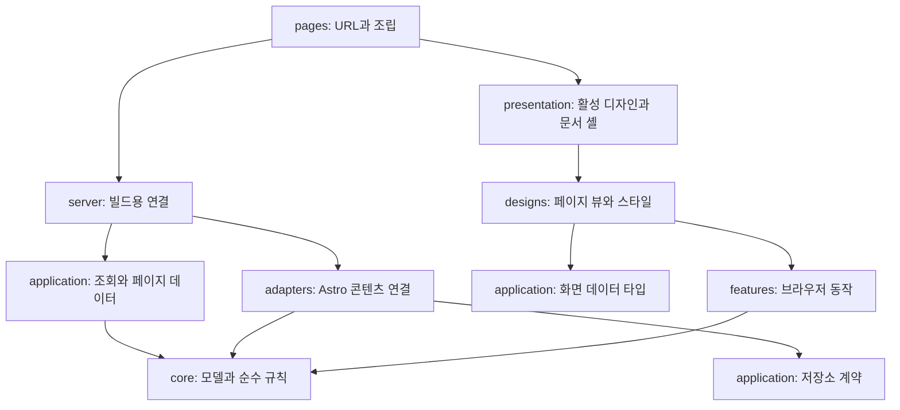

# 유지보수와 디자인 교체를 위한 상세 아키텍처

작성일: 2026-10-01 · 구현 현황 갱신: 2026-10-02 · 버전: 0.1

[기획서](./기획서.md)의 기능 범위를 구현하기 위한 모듈 경계와 변경 규칙이다. Astro 앱의 첫 구현은 이미 생성되었다. 이 문서는 원래 설계 방향과 예시 코드를 보존하며, 실제 파일·함수 시그니처는 현재 저장소를 기준으로 확인한다. 운영 절차는 [README](../README.md)와 [콘텐츠 작성 안내](./콘텐츠-작성.md)를 따른다.

### 첫 구현에서 확인되는 경계와 차이

| 원안 | 2026-10-02 구현 상태 |
| --- | --- |
| 콘텐츠·공개 정책 | `src/content.config.ts`, `src/adapters/astro-content/`, `src/application/public-catalog.ts`, `src/server/public-content.ts`에 연결했다. 초안·미래 발행 제외, 관계 ID 검증, 공개 콘텐츠 정렬을 사용한다. 전용 초안 미리보기 경로는 없다. |
| 화면 계약·본문 | `src/application/contracts/index.ts`와 `src/application/presenters/site.ts`를 사용한다. 첫 `PostVM`·`ProjectVM`은 일부 모델 메타데이터를 함께 가진다. 본문은 `src/adapters/astro-content/render-body.ts`로 렌더링해 페이지에서 슬롯으로 전달한다. 아래의 별도 `PostSummaryVM`과 `cover` 예시는 향후 계약 예시다. |
| 디자인·기능 | `src/presentation/active-design.ts`로 `studio` 뷰를 연결했다. Three.js 장면은 `src/designs/studio/hero/`에서 필요할 때 로드한다. 검색은 `/search/` 페이지이며 모달은 없다. 프로젝트는 기술 필터만 제공하고 목차는 정적 링크다. |
| 터미널·폰트 | 터미널 명령은 `src/features/terminal/commands.ts`의 분기문으로 처리하며 effect 객체는 controller가 실행한다. 명령 레지스트리는 아직 없다. 본문·UI는 자체 호스팅 Noto Sans KR, 코드·터미널은 시스템 고정폭 폰트를 사용한다. |
| 검증·배포 | `scripts/check-content.ts`, `scripts/check-boundaries.ts`, `scripts/check-output.ts`, 브라우저 테스트와 GitHub Actions 워크플로를 마련했다. 실제 GitHub Pages 공개 배포와 운영 성능 측정은 아직 수행하지 않았다. |

뒤의 코드 블록과 “해야 한다” 형태의 문장은 설계 계약 또는 후속 확장 방향이다. 위 현황과 다르면 구현된 동작으로 읽지 않는다.

## 1. 결정: 모듈형 단일 앱과 교체 가능한 표현 계층

Astro 앱 하나를 유지하면서 **콘텐츠 원본, 콘텐츠 규칙, 저장소 연결, 페이지 데이터, 디자인, 브라우저 동작**을 분리한다. 데이터 저장소와 디자인처럼 실제 교체가 예상되는 경계에만 인터페이스를 둔다. 폴더마다 클래스나 추상 팩토리를 만들지 않는다.

디자인 변경은 다음 네 수준으로 나눠 처리한다.

| 변경 수준 | 수정 위치 | 예시 |
| --- | --- | --- |
| 색·서체·간격·깊이 | 디자인의 토큰 | 오렌지 강조색 변경, 카드 그림자 조정 |
| 컴포넌트 외형 | 디자인의 컴포넌트 | 프로젝트 카드를 세로형에서 가로형으로 변경 |
| 페이지 구성 | 디자인의 페이지 뷰 | 홈에서 최근 글을 먼저 배치, 히어로 제거 |
| 전체 디자인 교체 | 새 디자인 폴더 + 활성 디자인 연결 | 3D 작업 공간을 에디토리얼 사이트로 변경 |

기존 페이지 데이터 안에서 해결되는 디자인 변경은 콘텐츠·발행 정책·라우팅·검색 로직에 영향을 주지 않는다. 새로운 정보를 보여주는 요구는 별도 기능 변경으로 취급한다. 예를 들어 기존 프로젝트를 리스트로 바꾸는 일과 프로젝트별 방문 통계를 새로 수집하는 일은 변경 범위가 다르다.

## 2. 모듈과 의존 규칙

다음 그림의 화살표는 **데이터 이동이 아닌 코드 import 방향**이다.



| 모듈 | 담당 | 허용하지 않는 책임 |
| --- | --- | --- |
| `core/` | Post·Project 모델, 공개 조건, 정렬·태그·관계 규칙, URL 함수 | Astro API, DOM, CSS, 파일 읽기 |
| `application/` | 저장소 계약, 공개 카탈로그, 홈·상세·목록 데이터, 탐색 인덱스 | 실제 파일 로딩, `.astro` 컴포넌트, Three.js |
| `adapters/astro-content/` | Astro 컬렉션 읽기, 원본→모델 변환, 본문 렌더링·이미지 처리 | 카드 모양, 홈 섹션 순서, 사용자 설정 |
| `server/` | 실제 adapter와 application 연결, 빌드 시점 설정, 공개 API | 브라우저 이벤트, 디자인 CSS |
| `pages/` | 경로 생성, 페이지 서비스 호출, 문서 셸과 뷰 조립 | 개별 공개 필터, 장문의 HTML, 디자인별 조건문 |
| `presentation/` | 활성 디자인 연결, 공통 HTML 문서·SEO·본문 경계 | 저장소 조회, 글별 예외 처리 |
| `designs/studio/` | 3D 화이트 디자인의 뷰·부품·토큰·장면 | 콘텐츠 직접 로딩, 발행 규칙, URL 직접 조합 |
| `features/` | 검색·필터·터미널·설정의 브라우저 로직 | 빌드 전용 코드 import, 특정 디자인 클래스 의존 |

`core`와 `application`에서는 `astro:content`를 import하지 않는다. 디자인에서는 application의 계약을 `import type`으로만 참조한다. 브라우저 진입점은 `server`, `adapters`, application의 빌드 서비스를 import하지 않는다. 빌드 코드는 브라우저에도 안전한 순수 함수·타입을 사용할 수 있지만 역방향 의존은 허용하지 않는다.

공개 진입점은 `server/public-content.ts`, `presentation/active-design.ts`, 각 기능의 `index.ts`로 제한한다. 기능 내부 파일을 외부에서 직접 참조하지 않는다. 모든 폴더에 무조건 `index.ts`를 만들거나 서버·클라이언트 코드를 하나의 barrel export에 섞지 않는다.

## 3. 권장 디렉터리

```text
content/                              # 글·프로필·프로젝트와 콘텐츠 이미지
src/
├── content.config.ts                 # 컬렉션 loader와 schema 연결
├── core/
│   ├── content.ts                    # Post, Project, Profile, ImageRef
│   ├── publication.ts                # 공개 가능 여부
│   ├── catalog.ts                    # 정렬·태그·관계 규칙
│   └── urls.ts                       # base·slug 기반 경로 생성
├── application/
│   ├── content-source.ts             # 읽기 전용 저장소 계약
│   ├── public-catalog.ts             # 공개 콘텐츠만 남기는 공통 진입점
│   ├── queries/                      # home, post, projects 등 사용 사례
│   ├── contracts/                    # 페이지 VM, PublicIndexItem 타입
│   └── presenters/                   # 모델→표시 데이터, 날짜·링크 변환
├── adapters/astro-content/
│   ├── schema.ts                     # 원본 필드 검증
│   ├── source.ts                     # getCollection 등 Astro 연결
│   ├── mapper.ts                     # 컬렉션 항목→core 모델
│   └── render-body.ts                # Content 컴포넌트·headings·이미지
├── server/
│   ├── context.ts                    # 빌드 기준 시각·site·base
│   ├── public-content.ts             # adapter와 조회 함수 연결
│   └── render-public-body.ts         # 공개 항목만 본문 렌더링 허용
├── pages/                            # 주소·getStaticPaths·조립만 담당
├── presentation/
│   ├── active-design.ts              # 현재 사용할 디자인 정적 export
│   ├── SiteDocument.astro            # html/head/SEO/공통 접근성 기반
│   └── ArticleBody.astro             # 본문 의미·검색 인덱싱 경계
├── designs/studio/
│   ├── views/                        # HomeView, PostView, ProjectsView 등
│   ├── components/                   # Header, PostList, ProjectCard 등
│   ├── ui/                           # 이 디자인의 Button, Badge 등
│   ├── styles/                       # primitive, semantic, prose CSS
│   └── hero/                         # Hero.astro, mount.ts, scene.ts, config.ts
├── features/
│   ├── preferences/                  # theme·motion 저장/복원
│   ├── filters/                      # URL 상태·필터 순수 함수·DOM 연결
│   ├── search/                       # 검색 계약·Pagefind adapter·controller
│   └── terminal/                     # parser·commands·reducer·controller
└── config/site.ts                    # 내비게이션·목록 개수 등 사이트 설정
public/designs/studio/                 # 3D 포스터·장식 자산
scripts/                              # 콘텐츠·아키텍처·산출물 점검
docs/                                 # 기획서·상세 설계·향후 작성 안내
```

폴더는 해당 기능 구현 시 생성한다. `queries/home.ts`가 몇 개 함수로 충분하면 더 세분화하지 않는다. 두 번째 디자인 폴더는 실제 개편 때 만들고, 두 번째 저장소 adapter도 CMS 도입 때 만든다.

## 4. 콘텐츠 경계: Repository / Adapter

저장소 인터페이스는 이 사이트에 필요한 읽기 동작만 표현한다. 관리자 기능이 없으므로 CRUD 전체나 범용 `Repository<T>`를 만들지 않는다.

```ts
// application/content-source.ts — 계약 일부
import type { Post, Project, Profile } from '../core/content';

export interface ContentSource {
  readPosts(): Promise<readonly Post[]>;
  readProjects(): Promise<readonly Project[]>;
  readProfile(): Promise<Profile>;
}
```

외부 블로그도 동일하게 필요한 조회를 추가한다. 여기서 Post·Project는 Astro의 `CollectionEntry`가 아닌 사이트가 소유한 모델이다. 날짜는 검증된 ISO 문자열, 관계는 안정적인 ID, 이미지는 프레임워크 독립적인 참조로 표현한다. 원본 스키마를 바꾸면 mapper에서 흡수하고, 모델이 같으면 화면까지 변경을 전파하지 않는다.

`getCollection()` 같은 Astro 접근은 `source.ts`에 모은다. 페이지와 디자인은 저장소를 직접 호출하지 않고 `server/public-content.ts`의 공개 조회만 사용한다. 컬렉션의 스키마·쿼리·본문 렌더링 역할은 [Astro Content Collections 문서](https://docs.astro.build/en/guides/content-collections/)를 기준으로 구현한다.

### 공개 정책은 한 번 정의하고 모든 산출물에 적용

첫 구현의 `createPublicCatalog(source, now)`가 초안·미래 발행을 제외하고 공개 관계를 계산한다. 페이지 목록, `getStaticPaths`, 상세 조회, RSS, 터미널 인덱스는 모두 이 카탈로그를 사용한다. 사이트맵과 Pagefind는 이 경로에서 생성된 공개 페이지를 대상으로 만든다.

`now`는 빌드 진입점에서 한 번 확정한 ISO 값을 모든 단계에 전달한다. 개별 파일이 각각 현재 시간을 읽지 않도록 해 빌드 도중 발행 시각을 넘더라도 목록·상세·RSS 결과가 달라지지 않게 한다. 캐시는 빌드 단위로 제한한다.

없는 관계 ID는 콘텐츠 검증 오류로 처리한다. 존재하지만 비공개인 항목을 참조하면 공개 페이지에서는 해당 관계를 제외한다. 공개 상세 조회에서 찾지 못한 항목은 경로를 생성하지 않는다. 초안 전용 미리보기는 후속 기능이며 첫 구현에는 없다.

## 5. 디자인 경계: View Model과 슬롯 합성

도메인 모델은 콘텐츠의 의미를, View Model은 화면에 전달할 데이터를 표현한다. 디자인 뷰는 VM을 받아 HTML을 만든다. 첫 구현은 표시 문자열과 링크를 presenter에서 준비하면서 모델 메타데이터 일부도 VM에 포함한다. 아래 코드는 더 분리된 계약의 설계 예시다.

```ts
// application/contracts/post.ts — 화면 계약 예시
export type PostSummaryVM = Readonly<{
  id: string;
  href: string;
  title: string;
  summary: string;
  section: 'dev' | 'life';
  publishedAt: string; // <time datetime>용 ISO 값
  publishedLabel: string;
  tags: readonly Readonly<{ label: string; href: string }>[];
  cover?: Readonly<{
    src: string;
    srcset?: string;
    width: number;
    height: number;
    alt: string;
  }>;
}>;
```

`tilt`, `shadow`, `className`, `gridColumn` 같은 디자인 속성은 VM에 넣지 않는다. 같은 `PostSummaryVM`을 목록 행, 썸네일 카드, 터미널 결과에 맞는 표현으로 변환할 수 있다. 터미널에는 더 작은 `PublicIndexItem`만 전달하고 UI 전체 모델을 직렬화하지 않는다.

홈 계약을 `featuredProjects`, `latestDevPosts`처럼 더 좁은 의미 단위로 나누는 것은 원안의 확장 방향이다. 현재는 공개 사이트 데이터에서 `HomeView.astro`가 섹션 순서와 표시 항목을 결정한다. 콘텐츠 JSON에 `HeroSection`, `BentoGrid` 같은 컴포넌트 이름을 저장하지 않는다.

### 본문은 데이터와 별도 렌더링 경로를 사용

Markdown 본문을 모든 VM에 HTML 문자열로 복사하지 않는다. 공개 항목의 ID로 본문 렌더러를 호출하고, 반환된 Astro `Content`와 목차를 페이지가 조립한다. 프레임워크 전용 반환형은 `server`·`presentation`·페이지 안에서만 사용한다.

```astro
---
// pages/blog/posts/[slug].astro — 조립 예시 일부
// getStaticPaths도 공개 카탈로그에서만 생성한다.
import { getPublicPostPage } from '../../../server/public-content';
import { renderPublicPostBody } from '../../../server/render-public-body';
import { PostView } from '../../../presentation/active-design';
import SiteDocument from '../../../presentation/SiteDocument.astro';
import ArticleBody from '../../../presentation/ArticleBody.astro';

const page = await getPublicPostPage(Astro.params.slug!);
const { Content, headings } = await renderPublicPostBody(page.post.id);
---
<SiteDocument seo={page.seo}>
  <PostView post={page.post} related={page.related} headings={headings}>
    <ArticleBody><Content /></ArticleBody>
  </PostView>
</SiteDocument>
```

`PostView`는 `<slot />`으로 본문을 배치하고, 헤더·목차·관련 글의 위치를 담당한다. `ArticleBody`는 본문 래퍼와 Pagefind 인덱싱 경계를 제공한다. 본문 제목 ID는 렌더링 단계에서 생성한 값을 유지하며 디자인에서 다시 만들지 않는다. 페이지 제목은 `h1`, Markdown의 주요 제목은 `h2`부터 작성한다. Astro의 props·슬롯 합성은 [공식 컴포넌트 문서](https://docs.astro.build/en/basics/astro-components/)를 따른다.

공통 문서 셸은 canonical·OG·구조화 데이터·언어·건너뛰기 링크를 소유한다. 디자인은 `main#main-content`를 한 번 제공하고, 본문 슬롯을 누락하지 않는 계약을 지킨다. 새로운 디자인이 SEO 메타 태그나 검색 경계를 빠뜨리는 문제를 공통 셸과 검증으로 막는다.

## 6. 디자인 교체 방식

빌드 시 하나의 활성 디자인을 정적 import로 선택한다. 초기에는 `studio` 하나만 존재한다.

```ts
// presentation/active-design.ts — 공개 연결 일부
export { default as HomeView } from '../designs/studio/views/HomeView.astro';
export { default as PostView } from '../designs/studio/views/PostView.astro';
export { default as ProjectsView } from '../designs/studio/views/ProjectsView.astro';
```

실제 공개 연결에는 프로필·글 목록·프로젝트 상세·태그·검색·터미널·404 등 필요한 뷰도 포함한다. 각 뷰는 공통 계약을 `Props`로 받아 타입 검사를 통과해야 한다. 서로 다른 디자인 폴더끼리 직접 import하지 않는다.

전체 개편 시 새 폴더의 뷰를 만든 뒤 이 연결 파일을 바꾼다. 선택하지 않은 디자인의 스크립트·스타일을 일괄 import하지 않는다. 모든 페이지에 `if (design === ...)`를 흩뿌리는 방식이나 방문자용 디자인 선택기는 초기 범위에 넣지 않는다.

일반 웹의 라이트·다크는 같은 디자인의 색상 변형이다. 터미널은 별도 탐색 경험이며 동일한 기능 controller에 다른 마크업을 붙일 수 있다. 저장하는 상태는 색상 선호도와 모션 설정이고, 현재 탐색 경험은 URL 경로가 기준이다.

### 토큰은 원시값 → 의미 → 컴포넌트 순으로 적용

```css
/* 디자인 소유 파일의 예시. 페이지에서는 의미 토큰을 사용한다. */
:root {
  --palette-paper: #fafaf8;
  --palette-ink: #18181b;
  --space-4: 1rem;
  --color-background: var(--palette-paper);
  --color-text: var(--palette-ink);
  --surface-raised: #fff;
  --elevation-card: 0 12px 32px rgb(0 0 0 / 0.08);
  --motion-fast: 180ms;
}
:root[data-theme='dark'] {
  --color-background: #141416;
  --color-text: #f5f5f5;
  --surface-raised: #202023;
}
```

UI 컴포넌트는 `--color-text`, `--surface-raised`처럼 용도를 나타내는 값을 사용한다. 토큰은 컴포넌트 외형 변경에 도움을 주지만 레이아웃 전체를 바꾸는 도구로 과장하지 않는다. 마크업 변경은 뷰와 컴포넌트에서 명시적으로 수행한다.

스타일 규칙은 다음과 같다.

- reset과 의미 토큰만 전역 기반으로 둔다. 카드·헤더·버튼은 Astro 컴포넌트 범위 스타일로 작성한다.
- Markdown 본문에는 디자인 소유 `prose.css`를 사용하고 `[data-article-body]` 아래로 선택자를 제한한다. 자식 본문까지 전달해야 하므로 범위가 명확한 전역 스타일로 처리한다.
- 카드 변형은 `variant="featured"`처럼 의미가 있는 소수의 옵션으로 제한한다. `isFlat`, `isWide`, `isGlass`, `isTilted` 같은 불리언 조합은 쌓지 않는다.
- 상태 스타일은 `aria-expanded`, `data-state`를 사용한다. 기능 코드가 `orange-card` 같은 시각적 클래스명을 조회하지 않는다.
- 외부에서 자식의 내부 CSS 선택자를 덮어쓰지 않는다. 변경이 필요하면 props·슬롯·공개 토큰을 추가하거나 컴포넌트를 수정한다.

Astro의 컴포넌트 범위 스타일과 전역 스타일 구분은 [Styles and CSS 문서](https://docs.astro.build/en/guides/styling/)에 맞춘다.

## 7. 동작과 화면 분리: 작은 Headless Controller

검색·필터·터미널은 상태와 동작을 TypeScript로 작성하고, 디자인 뷰는 마크업을 제공한다. 각 기능은 `mount(root, options)`로 연결하고 `dispose()`로 정리한다. 전체 사이트용 이벤트 버스나 전역 상태 저장소를 기본으로 두지 않는다.

| 기능 | 순수 로직·계약 | 브라우저 연결 | 디자인이 담당 |
| --- | --- | --- | --- |
| 필터 | 조건 적용, URL 파싱·직렬화 | 입력·탭 이벤트, 결과 갱신, popstate | 탭·목록·빈 상태 외형 |
| 검색 | `search(query, filters)` 결과 계약 | Pagefind adapter, 입력 지연 처리, 늦게 온 응답 무시 | 검색 페이지의 입력창·결과·오류 배치; 모달은 후속안 |
| 터미널 | 명령 파싱, 경로 처리, Command registry, reducer | 입력·기록·포커스·스크롤 | 프롬프트·출력·분할 뷰어 |
| 사용자 설정 | theme·motion 값과 기본값 | 저장·복원, OS 선호도 구독 | 설정 버튼·표시 |

DOM 연결 계약은 각 기능 README에 root, 필수 `data-*` 요소, 입력 데이터, 발생시키는 이벤트, 정리 동작을 기록한다. 검색 예시는 `[data-search-input]`, `[data-search-results]`, `[data-search-status]`다. 디자인 개편 시 이 계약을 만족하면 검색 로직을 다시 작성할 필요가 없다. DOM 구조가 달라 계약을 유지하기 어렵다면 해당 기능의 DOM 연결부만 바꾼다.

필터의 현재 값은 URL이 기준이다. 모달 열림·선택 인덱스 상태는 모달을 도입할 경우의 후속 설계다. 정적 호스팅에서는 query string에 따라 서버 HTML이 바뀌지 않으므로 최초 HTML에는 기본 목록을 제공하고, 브라우저 초기화 시 URL 필터를 적용한다. JavaScript가 없을 때도 `/blog/dev/`, `/blog/life/`, 태그별 정적 경로로 분류 탐색이 가능하다.

터미널 Command가 `{ nextState, output, effects }` 형태의 결과를 반환하는 것은 원안의 확장 방향이다. 첫 구현의 명령 분기와 UI 연결은 `src/features/terminal/commands.ts`, `index.ts`에 있다. 명령 처리와 화면 연결은 새 명령을 추가할 때 현재 코드 기준으로 검토한다.

제공 문자열은 텍스트 노드로 출력하고 입력을 HTML로 삽입하지 않는다. 검색 실패는 재시도와 기본 탐색 링크, 알 수 없는 명령은 도움말로 연결한다. 모달을 추가한다면 닫을 때 실행한 버튼으로 포커스를 복원한다. 이벤트와 observer는 기능 root 안에 연결하고 해제한다.

## 8. 3D는 디자인 내부의 독립 기능으로 제한

3D의 모델·재질·카메라 구도는 `designs/studio/hero/`가 소유한다. 콘텐츠 저장소나 프로젝트 모델이 Three.js 타입을 알지 못하게 한다. 장면에는 팔레트·모션 허용 여부·크기 같은 표현용 설정만 전달한다.

`Hero.astro`는 소개·링크·포스터와 고정된 캔버스 공간을 제공한다. `mount.ts`는 로딩·가시성·정리를 관리하고, `scene.ts`는 Three.js 객체 생성과 렌더링만 담당한다. 장면 교체는 `scene.ts`와 `config.ts`, 3D 전체 제거는 히어로 뷰에서 처리한다.

생명주기는 `poster → loading → ready → paused → disposed`로 정의한다. 로딩 오류는 `poster`로 복귀하고 무한 재시도하지 않는다. 동적 import 도중 컴포넌트가 제거되면 완료 후 장면을 생성하지 않는다. `dispose()`는 여러 번 호출해도 안전해야 하며 렌더 루프, 이벤트, observer, geometry·material·texture·renderer를 정리한다.

사용자 motion 설정과 OS의 동작 줄이기 설정을 공통 설정 모듈에서 읽는다. Three.js는 히어로의 브라우저 진입점에서만 동적으로 import한다. 일반 글 상세와 터미널에는 3D 청크 요청이 없어야 한다. 새 디자인이 3D를 쓰지 않으면 이 모듈 전체가 필요하지 않다.

## 9. 실제 변경 시나리오와 영향 범위

| 요청 | 주로 수정하는 파일 | 확인할 계약 |
| --- | --- | --- |
| 글 한 편 추가 | `content/posts/...md`, 콘텐츠 이미지 | 스키마·공개 시각·관계·링크 |
| 이름·이력 변경 | `content/profile/profile.json` | 긴 이름·빈 선택 필드의 화면 처리 |
| 카드 모서리·색 변경 | `designs/studio/styles/`, 카드 CSS | 대비·포커스·모바일 |
| 홈 섹션 재배치 | `designs/studio/views/HomeView.astro` | 제목 구조·읽기 순서 |
| 새 데이터가 필요한 홈 영역 추가 | 콘텐츠 스키마·모델·query·VM·홈 뷰 | 데이터 계약 변경 및 기존 글 호환 |
| 3D를 일러스트로 교체 | `designs/studio/hero/`, 디자인 자산 | 3D 청크 제거·LCP·레이아웃 이동 |
| 전면 리디자인 | 새 `designs/<name>/`와 `active-design.ts` | 페이지 Props·본문 슬롯·DOM hook·URL |
| 저장소를 CMS로 변경 | 새 adapter, `server` 연결, 본문·이미지 변환 | ID·slug·발행 시각·Markdown 표현 보존 |
| 검색 엔진 교체 | `features/search/`의 adapter | 동일 검색 결과 계약·오류·필터 |
| 새 터미널 명령 추가 | `features/terminal/commands/`와 registry | 파싱·상태·effect 검증 |

CMS 전환은 메타데이터 adapter만으로 끝난다고 가정하지 않는다. 본문 형식과 이미지 경로도 이전해야 한다. Markdown을 유지하면 기존 본문 경계를 재사용하고, 다른 본문 형식을 도입하면 같은 슬롯 결과를 제공하도록 렌더러를 교체한다.

## 10. 유지보수를 위한 검증과 변경 규칙

자동 검증은 실제로 깨지기 쉬운 경계에 집중한다.

| 검증 | 잡아낼 문제 |
| --- | --- |
| import 경계·순환 참조 | 디자인이 저장소 직접 조회, 브라우저에 서버 코드 유입 |
| 콘텐츠 검증 | 중복 ID·slug, 유효하지 않은 날짜, 누락 이미지·관계 |
| 공개 카탈로그 검증 | 초안·미래 글이 페이지·RSS·탐색 인덱스에 노출 |
| URL 검증 | 사용자 페이지와 저장소 하위 경로의 이미지·검색·링크 오류 |
| 타입 검사 | 새 디자인이 필수 Props나 VM 필드를 잘못 사용 |
| 기능 단위 검증 | 필터 조합·뒤로 가기·터미널 명령·검색 응답 순서 |
| 빌드 산출물 검증 | 본문·canonical·제목·앵커·검색 대상이 빠짐 |
| 대표 브라우저 흐름 | 키보드·터치·테마·모션·포스터 폴백·자원 정리 |

첫 구현의 import 경계는 `scripts/check-boundaries.ts`로 검사한다. ESLint 규칙이나 별도 순환 참조 도구는 원안의 확장 선택지다. 컴포넌트 props를 그대로 다시 확인하는 테스트나 모든 DOM을 고정하는 대형 스냅샷은 기본으로 만들지 않는다. 디자인 변경이 잦은 화면은 홈·긴 글·프로젝트 상세·터미널의 대표 화면을 데스크톱/모바일로 확인한다.

리디자인 완료 조건은 같은 콘텐츠로 이전·새 디자인을 각각 빌드했을 때 공개 URL 목록, 제목·본문 의미, 본문 앵커, RSS 항목, 검색 결과 대상이 유지되는 것이다. HTML 전체 일치를 요구하지 않는다. 임시 검증용 디자인이 필요하면 테스트 fixture로 최소한만 만들고 제품에 두 디자인을 상시 탑재하지 않는다.

콘텐츠 스키마에 필수 필드를 추가할 때는 기본값 또는 일괄 이전을 함께 준비한다. 안정 ID는 재생성하지 않고, slug 변경 시 이전 경로를 처리한다. 한 번 사용한 UI를 곧바로 공통화하지 않으며, 두 곳 이상에서 같은 의미와 수정 이유를 공유할 때 추출한다.

## 11. 원래 구현 순서

1. 콘텐츠 스키마와 순수 모델, 공개 정책, URL 규칙을 만든다.
2. Astro adapter와 공개 카탈로그를 연결하고 초안·관계·경로 검증을 완료한다.
3. 글 상세 한 페이지를 `서비스 → VM → 뷰 + 본문 슬롯` 구조로 끝까지 구현한다.
4. 같은 데이터로 목록과 홈을 구현하고, 활성 디자인 연결과 토큰 경계를 확인한다.
5. 검색·필터·터미널을 기능별 controller로 붙인다.
6. 화이트 히어로에 3D를 붙이고 로딩·정리·포스터 폴백을 검증한다.
7. 디자인 교체 점검과 정적 배포 검증을 수행한다.

위 순서는 최초 작업 순서이며 현재의 완료 목록은 아니다. 첫 구현에서 글 상세와 공통 콘텐츠 경계를 만들었고, 추가 기능은 실제 필요가 생기는 시점에 계약을 확장한다.
